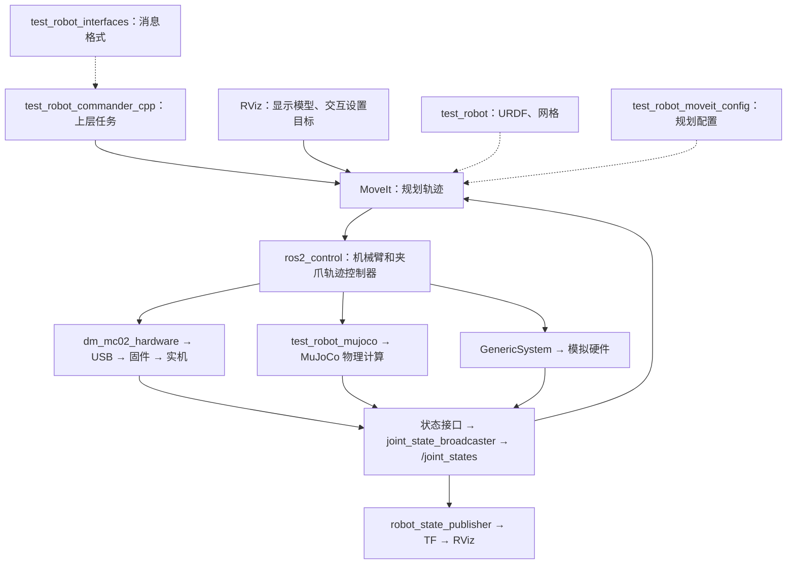
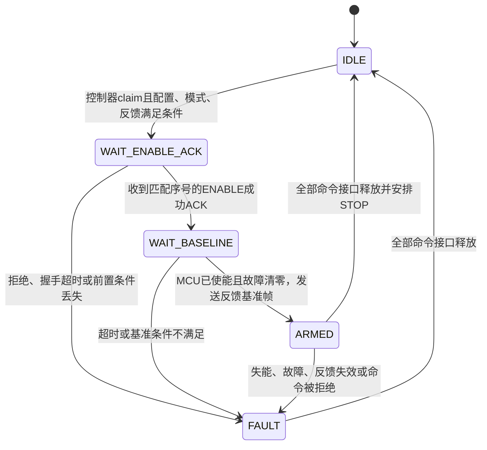

# ros_test_8 代码阅读指南

更新时间：2026-11-18。本文根据当前 `src` 源码整理，介绍各包的职责、关键代码和调用关系。

工作区位置：`C:\Users\lenovo\Desktop\ros_test_8`。文中的相对链接以本文件所在的 `src` 为起点，可直接点击查看源码。本文说明代码当前的设计与行为，不代表完整 ROS 启动和实机运动已经验证。

## 1. 先认识整个工程

这套工程把机械臂控制拆成几层：

1. **模型层**：描述机械臂长什么样、关节如何连接。
2. **规划层**：计算从当前位置到目标位置的轨迹。
3. **控制层**：按时间从轨迹中计算当前关节指令。
4. **执行层**：把指令交给真实固件、MuJoCo 或模拟硬件。
5. **反馈层**：把关节实际状态交回控制器、MoveIt 和显示界面。



这里有三种执行后端。选择不同启动文件，就会加载不同后端；在当前默认节点名和话题配置下，它们不是同时启动的一条控制链。

## 2. src 目录总览

```text
src/
├── .vscode/                   VS Code 设置与索引
├── test_robot/                机器人结构与外观模型
├── test_robot_interfaces/     自定义消息定义
├── test_robot_moveit_config/  MoveIt 规划配置
├── test_robot_commander_cpp/  C++ 上层命令与任务程序
├── test_robot_bringup/        原有模拟硬件演示启动包
├── test_robot_mujoco/         MuJoCo 物理仿真后端
└── dm_mc02_hardware/          USB 实机硬件后端
```

除 `.vscode` 外，上面七个目录都是 ROS 2 包。一个包可以提供节点、插件、消息或配置，并不一定是一个独立运行的程序。

常见子目录和文件的含义：

| 名称 | 含义 | 修改后通常需要做什么 |
|---|---|---|
| `src/` | C++ 实现 | 重新构建对应包 |
| `include/` | C++ 类声明、接口和头文件实现 | 重新构建依赖这些头文件的包 |
| `launch/` | 启动哪些节点、加载哪些参数 | 确保安装目录更新，然后重新启动 |
| `config/` | YAML、SRDF、RViz 等配置 | 确保安装目录更新，然后重新启动 |
| `urdf/` | 机器人描述与 Xacro 模板 | 更新描述并重新启动相关节点 |
| `meshes/` | 连杆外观、碰撞用的几何模型 | 更新安装内容并重新加载模型 |
| `msg/` | 自定义消息格式 | 重新构建消息包及使用它的程序 |
| `test/` | 自动化测试 | 按测试入口执行 |
| `package.xml` | 包名、依赖和导出信息 | 修改依赖时重新解析依赖并构建 |
| `CMakeLists.txt` | 编译哪些目标、安装哪些文件、注册哪些测试 | 重新构建 |

工作区外层的 `build/` 是构建产物，`install/` 是运行时查找的安装内容，`log/` 是构建和测试日志。**日常修改以 `src/` 为准**，不要把修改安装目录当作修改源代码。

## 3. test_robot：机器人本体模型

入口：[test_robot.urdf](test_robot/urdf/test_robot.urdf)。

URDF 中主要看以下元素：

| 元素 | 你能从中读到什么 |
|---|---|
| `link` | 一个刚性连杆的外观、碰撞形状、质量和惯性 |
| `joint` | 两个连杆之间的连接关系 |
| `parent` / `child` | 关节连接的父连杆和子连杆 |
| `origin` | 安装位置和方向，决定几何关系 |
| `axis` | 关节正方向，不等于电机接线方向 |
| `limit` | 位置、速度、力或力矩限制 |
| `mimic` | 跟随另一个关节运动的关系 |

该包的主要目录：

- `urdf/`：机械臂描述。
- `meshes/`：STL 外观模型；`meshes/collision/` 提供碰撞用网格。
- `rviz/`：模型显示布局。
- `launch/`：模型显示入口。

[display.launch.xml](test_robot/launch/display.launch.xml) 启动 `robot_state_publisher`、关节滑块界面和 RViz。它适合检查关节旋转方向和连杆连接，不负责 USB 实机通信。

**关节编号要分清：**当前实机插件导出 `joint1`～`joint6` 和 `joint8`，共七个受控关节。协议第七路对应夹爪电机，ROS 名称是 `joint8`，不要按名字把它理解成协议第八路。模型中的其他夹爪关节还用于机构联动。

## 4. test_robot_interfaces：程序之间的消息约定

核心文件：[PoseCommand.msg](test_robot_interfaces/msg/PoseCommand.msg)。

```text
float64 x
float64 y
float64 z
float64 roll
float64 pitch
float64 yaw
bool cartesian_path
```

`commander` 将位置按米解释，姿态角按弧度解释；当前代码把目标参考坐标系固定为 `base_link`。消息自身没有时间戳或 `frame_id` 字段。

[CMakeLists.txt](test_robot_interfaces/CMakeLists.txt) 中的 `rosidl_generate_interfaces()` 会根据 `.msg` 生成 C++ 等语言可使用的类型。因此应用代码能包含：

```cpp
#include <test_robot_interfaces/msg/pose_command.hpp>
```

这个包只定义格式；“收到消息后规划还是直接运动”由使用它的节点决定。

## 5. test_robot_moveit_config：运动规划配置

这个包提供 MoveIt 使用的机器人语义、逆运动学、规划器及控制器连接信息。

| 文件 | 重点看什么 |
|---|---|
| [test_robot.srdf](test_robot_moveit_config/config/test_robot.srdf) | `arm`、`gripper` 规划组；命名姿态；被动关节；碰撞排除关系 |
| [kinematics.yaml](test_robot_moveit_config/config/kinematics.yaml) | 从末端位姿求关节角度的求解器配置 |
| [ompl_planning.yaml](test_robot_moveit_config/config/ompl_planning.yaml) | 路径规划算法及参数 |
| [joint_limits.yaml](test_robot_moveit_config/config/joint_limits.yaml) | 通用规划速度、加速度及默认缩放 |
| [moveit_controllers.yaml](test_robot_moveit_config/config/moveit_controllers.yaml) | MoveIt 向哪个控制器 action 发送轨迹 |
| [ros2_controllers.yaml](test_robot_moveit_config/config/ros2_controllers.yaml) | 该套配置中的控制器参数 |
| [test_robot.ros2_control.xacro](test_robot_moveit_config/config/test_robot.ros2_control.xacro) | 通用入口加载的模拟硬件插件 |
| [move_group.launch.py](test_robot_moveit_config/launch/move_group.launch.py) | 构建 MoveIt 配置并启动规划服务 |

理解它时要区分三个概念：

- **逆运动学**：给定末端位置和姿态，求一组关节角度。
- **路径规划**：在起点和终点之间寻找符合约束的路径。
- **轨迹执行**：把带时间信息的关节轨迹发送给控制器，由控制器逐周期执行。

当前通用 Xacro 使用 `mock_components/GenericSystem`。实机入口会复用此包的配置，但覆盖机器人描述与规划限位，具体见第 9 节。修改通用 `joint_limits.yaml` 不等于已经修改了实机入口最终采用的限位。

## 6. test_robot_commander_cpp：上层命令与任务逻辑

[CMakeLists.txt](test_robot_commander_cpp/CMakeLists.txt) 编译两个可执行程序：

| 可执行程序 | 源文件 | 用途 |
|---|---|---|
| `commander` | [commander_template.cpp](test_robot_commander_cpp/src/commander_template.cpp) | 接收话题命令，调用 MoveIt |
| `test_moveit` | [test_moveit.cpp](test_robot_commander_cpp/src/test_moveit.cpp) | 运动规划与执行示例 |

`Commander` 的阅读顺序：

```text
main()
  ├─ 初始化 ROS 节点
  ├─ 构造 Commander
  │    ├─ 创建 arm / gripper 的 MoveGroupInterface
  │    └─ 注册三个话题订阅
  └─ spin() 等待并处理回调
```

话题与函数的关系：

| 话题 | 消息类型 | 回调与后续调用 |
|---|---|---|
| `joint_command` | `example_interfaces/msg/Float64MultiArray` | `jointCmdCallback()` → `goToJointTarget()` → `planAndExecute()` |
| `pose_command` | `test_robot_interfaces/msg/PoseCommand` | `poseCmdCallback()` → `goToPoseTarget()` |
| `open_gripper` | `example_interfaces/msg/Bool` | `openGripperCallback()` → `openGripper()` 或 `closeGripper()` |

`joint_command` 当前要求六个值，单位为 rad。`pose_command` 在 `cartesian_path=false` 时走常规目标规划，在 `true` 时调用 `computeCartesianPath()`。`planAndExecute()` 先规划，成功后才调用 `execute()`。

这两个程序都包含真实的执行调用，不能把“示例程序”理解为只预览轨迹。当前机械臂常规规划请求设置了 0.1 的速度和加速度缩放；这不意味着所有路径生成方式都已经完成实机验证。

**当前源码的一处名称不一致：**`closeGripper()` 请求 `gripper_closed`，而 SRDF 定义的是 `gripper_close`。阅读或调试关闭夹爪功能时，应先核对这一处。本指南只记录现状，未修改该调用。

## 7. test_robot_bringup：原有模拟硬件启动包

入口：[test_robot.launch.xml](test_robot_bringup/launch/test_robot.launch.xml)。

它启动：

1. `robot_state_publisher`：根据关节状态计算连杆坐标变换。
2. `ros2_control_node`：加载模拟硬件和控制器管理器。
3. 三个 spawner：加载关节状态广播器、机械臂控制器和夹爪控制器。
4. MoveIt 的 `move_group`。
5. RViz。

该入口加载的是 `test_robot_moveit_config` 中的模拟硬件 Xacro；实际加载的控制器参数来自 [controller_manager.yaml](test_robot_bringup/config/controller_manager.yaml)。判断一个配置文件是否生效，要看 launch 是否实际引用它。

它适合验证规划与控制接口能否连通；不连接 MCU，也不做 MuJoCo 物理计算。

## 8. test_robot_mujoco：物理仿真后端

入口：[mujoco.launch.py](test_robot_mujoco/launch/mujoco.launch.py)。详细安装与仿真约定见 [README](test_robot_mujoco/README.md)。

| 文件 | 职责 |
|---|---|
| [mujoco_system.cpp](test_robot_mujoco/src/mujoco_system.cpp) | `MujocoSystem` 硬件插件；加载物理模型、接收位置指令、推进仿真并返回状态 |
| [generate_model.py](test_robot_mujoco/scripts/generate_model.py) | 将原始 URDF/SRDF 和网格转换成 MuJoCo 使用的模型资源 |
| [viewer.py](test_robot_mujoco/scripts/viewer.py) | 显示后端发布的物理状态 |
| [joint_telemetry.py](test_robot_mujoco/scripts/joint_telemetry.py) | 缓存最新反馈、更新显示模型、生成关节力矩文字 |
| `test/` | 模型、遥测和硬件插件测试 |

`MujocoSystem` 和实机的 `DmMc02System` 都实现 `hardware_interface::SystemInterface`，因此上层可以使用相同类型的轨迹控制器。

注意数据来源：

- `/joint_states`：通过状态广播器发布的受控关节状态。
- `/mujoco/joint_states`：仿真后端额外发布的完整物理关节状态。
- `/mujoco/joint_targets`：仿真后端发布的受控关节目标信息。

viewer 是状态查看器，物理仿真在硬件插件中推进。窗口中的关节力矩包含仿真补偿项，不能直接当作实机电机测量值。

## 9. dm_mc02_hardware：实机驱动，建议重点阅读

详细操作步骤见 [实机 README](dm_mc02_hardware/README.md)。该包负责把 ROS 关节指令转换为当前固件的 USB 协议，并将反馈转换回 ROS 状态。

### 9.1 先看文件分工

| 文件 | 所处层次 | 主要职责 |
|---|---|---|
| [bringup.launch.xml](dm_mc02_hardware/launch/bringup.launch.xml) | 启动入口 | 接收参数，转发到 Python 启动文件 |
| [bringup.launch.py](dm_mc02_hardware/launch/bringup.launch.py) | 节点组装 | 启动实机控制、状态发布及可选 MoveIt/RViz |
| [real_model.py](dm_mc02_hardware/launch/real_model.py) | 模型适配 | 根据标定映射计算实机可用范围，移除越界命名姿态 |
| [test_robot_real.urdf.xacro](dm_mc02_hardware/urdf/test_robot_real.urdf.xacro) | 描述入口 | 引入机器人模型及实机硬件配置 |
| [dm_mc02.ros2_control.xacro](dm_mc02_hardware/urdf/dm_mc02.ros2_control.xacro) | 标定与插件配置 | 关节方向、零位、固件限位、夹爪标定和控制开关 |
| [ros2_controllers.yaml](dm_mc02_hardware/config/ros2_controllers.yaml) | 控制器配置 | 关节列表、更新频率、轨迹与到位误差阈值 |
| [dm_mc02_system.cpp](dm_mc02_hardware/src/dm_mc02_system.cpp) | ROS 接口层 | 生命周期、命令/状态接口、每周期读写 |
| [arm_link.cpp](dm_mc02_hardware/src/arm_link.cpp) | 链路控制层 | 握手、首帧保持、命令检查、故障处理 |
| [frame_codec.hpp](dm_mc02_hardware/include/dm_mc02_hardware/frame_codec.hpp) | 编解码层 | 帧生成、CRC、字节流解析和字段读取 |
| [arm_protocol.hpp](dm_mc02_hardware/include/dm_mc02_hardware/arm_protocol.hpp) | 协议定义 | 消息类型、错误码、字段结构和单位换算 |
| [serial_port.cpp](dm_mc02_hardware/src/serial_port.cpp) | 串口层 | Linux 串口打开、配置、读写和关闭 |

### 9.2 DmMc02System：ROS 每个周期如何调用驱动

这个类是动态加载的硬件插件，不是单独运行的 `main()` 程序。插件名称通过 [pluginlib_export_plugin.xml](dm_mc02_hardware/pluginlib_export_plugin.xml) 导出，由 `ros2_control` 根据 Xacro 配置加载。

| 函数 | 当前作用 |
|---|---|
| `on_init()` | 检查七个关节及顺序，加载并校验参数 |
| `export_state_interfaces()` | 提供 position、velocity、effort 状态接口 |
| `export_command_interfaces()` | 提供 position 命令接口 |
| `on_configure()` | 打开串口，创建 `ArmLink` 和单调时钟 |
| `on_activate()` | 激活硬件接口；此时不会仅因硬件激活就发送 ENABLE |
| `prepare_command_mode_switch()` | 检查即将启用的命令接口是否允许控制 |
| `perform_command_mode_switch()` | 更新各关节被控制器占用的状态，并初始化/清理命令 |
| `read()` | 读串口，调用 `ArmLink::receive()`，更新状态接口 |
| `write()` | 复制本周期控制器命令，调用 `ArmLink::step()`，发送生成的帧 |
| `on_deactivate()` / `on_cleanup()` | 发送停止/失能，重置或释放运行资源 |

“claim 接口”指控制器取得某个关节命令接口的使用权。当前驱动只让已被 claim 的关节接受新目标。

控制器管理器的主要周期关系是：

```text
read()       读取实际反馈
    ↓
update()     轨迹控制器根据反馈和时间计算当前目标
    ↓
write()      将本周期目标交给实机驱动发送
```

因此排查“命令为何没发出去”，除了看串口，还要看控制器是否 active、是否 claim 了对应接口，以及 `ArmLink` 是否允许发送。

### 9.3 ArmLink：实机使能状态机

类声明和配置结构见 [arm_link.hpp](dm_mc02_hardware/include/dm_mc02_hardware/arm_link.hpp)。



关键函数：

- `receive()`：按接收顺序处理每个完整 STATE/ACK，更新反馈与超时状态。
- `try_arm()`：检查前置条件，发送 ENABLE，并记录其序号。
- `handle_ack_frame()`：匹配 ENABLE ACK；记录命令拒绝。
- `send_baseline()`：将七路原始反馈整数直接作为首帧目标。
- `send_command()`：处理已 claim 的关节命令，检查数值、限位和步长。
- `feedback_ready()`：检查最近 STATE、反馈有效位、反馈年龄和故障标志。
- `disarm()`：记录原因，锁存 FAULT，并安排 STOP。

`ARMED` 表示主机已经进入连续发送阶段，不等于机械臂已经到达目标。固件的 `RUNNING` 表示它有有效 PC 指令，也不等于轨迹执行成功。

### 9.4 命令与反馈的完整路径

以 `joint_command` 为例：

```text
发布六个目标角度
  → Commander::jointCmdCallback()
  → MoveGroupInterface 规划并执行
  → /arm_controller/follow_joint_trajectory
  → arm_controller 按时间生成关节位置指令
  → DmMc02System::write()
  → ArmLink::step() / send_command()
  → FrameEncoder::encode_position_cmd()
  → SerialPort::write()
  → USB CDC
  → 固件处理 POSITION_CMD
  → 固件插补并驱动电机
```

反馈返回：

```text
电机反馈 → 固件 STATE → USB CDC
  → SerialPort::read()
  → ArmLink::receive() / FrameDecoder
  → handle_state_frame()：单位和坐标转换
  → DmMc02System 状态接口
  ├─ 轨迹控制器读取状态
  └─ joint_state_broadcaster → /joint_states
       ├─ MoveIt 更新当前位置
       └─ robot_state_publisher → TF → RViz
```

### 9.5 单位和标定：读代码时最容易混淆的地方

| 数据 | ROS 侧 | USB 协议侧 |
|---|---|---|
| J1～J6 位置 | rad，URDF 关节坐标 | int32，电机侧 µrad |
| J1～J6 速度 | rad/s | int32，µrad/s |
| J1～J6 力矩 | N·m | int32，mN·m |
| joint8 位置 | m，夹爪直线关节位移 | 第七路电机角度，µrad |

六轴角度转换：

```text
反馈：q_ros = sign × (q_mcu − offset)
命令：q_mcu = sign × q_ros + offset
```

`sign` 只能取 +1 或 -1；`offset` 是 URDF 零位对应的电机角度，需要实测。固件中的某个预设位置或回零目标，不自动等于 URDF 的零位偏置。

夹爪单独通过开/闭两端的电机角度与直线位移建立线性映射。**电机硬限位不是开合标定端点。** 当前未标定时，joint8 的米制反馈为 NaN；原始电机角度仍记录在日志的 `grip_motor`。禁用夹爪命令时，它保持首帧原始角度，不经过开合映射。

### 9.6 当前参数如何生效

实机启动参数有：

| 参数 | 默认值 | 用途 |
|---|---|---|
| `device` | `/dev/ttyACM0` | USB 虚拟串口设备 |
| `allow_enable` | `0` | 是否允许 PC 使能；设为 1 仍要满足标定、反馈和模式条件 |
| `use_moveit` | `false` | 是否启动采用实机模型的 MoveIt |
| `use_rviz` | `false` | 是否启动 RViz |

标定参数位于硬件 Xacro 中，包括 `mapping_calibrated`、各轴 `sign/offset`、`grip_calibrated` 和夹爪端点。它们不是当前 launch 暴露的同名命令行参数。

标定完成后，`real_model.py` 为实机计算：

```text
ROS 可用位置范围 = 原 URDF 范围 ∩ 根据 sign/offset 转换后的电机限位
```

空交集会报错；旧 SRDF 中超出该范围的命名姿态会被移除。机械臂实机规划速度上限为 0.4 rad/s，加速度上限为 0.8 rad/s²；夹爪则按标定比例转换。

当前固件的 PC 插补上限为 0.5 rad/s、1 rad/s²。ROS 位置命令的速度限制字段发送 0，含义是采用固件默认上限。

### 9.7 周期、超时和恢复

| 项目 | 当前设置/行为 |
|---|---|
| 控制器管理器更新率 | 100 Hz |
| 固件 STATE | 约 100 Hz |
| ROS POSITION_CMD | 正常连续运行时每 20 ms 生成一次 |
| 指令有效期 | 默认 100 ms |
| STATE 接收超时 | 默认 100 ms |
| 单轴反馈有效期 | 固件上报年龄 + 主机接收后经过时间不超过 100 ms |
| ENABLE 握手超时 | 200 ms |
| 默认单帧最大步长 | 0.01 rad，夹爪也按电机角度判断 |

FAULT 后不会因反馈恢复自动重启旧轨迹。释放全部命令接口后才可再次尝试使能。历史通信/反馈故障可由成功 ENABLE 清除，当前 CAN 故障或电机使能失败仍会阻止使能。

协议中定义了 FAULT 和 DIAGNOSTIC 类型；当前 ROS 主要通过 STATE 获取固件故障状态，编解码器没有把诊断页解码成完整的 ROS 诊断信息。不要因为枚举中存在某个类型，就认为对应功能已经全部接入。

## 10. 三种运行方式怎么选择

以下命令应在已经构建并 source 的 Ubuntu/ROS 2 工作区终端中运行。

| 目的 | 启动入口 | 执行后端 |
|---|---|---|
| 只看模型和关节连接 | `ros2 launch test_robot display.launch.xml` | 关节滑块与显示 |
| 测试原有规划演示 | `ros2 launch test_robot_bringup test_robot.launch.xml` | GenericSystem 模拟硬件 |
| 物理仿真 | `ros2 launch test_robot_mujoco mujoco.launch.py` | MuJoCo |
| 实机只读遥测 | `ros2 launch dm_mc02_hardware bringup.launch.xml allow_enable:=0` | USB 实机 |

实机使能和 MoveIt 的完整步骤见 [实机 README](dm_mc02_hardware/README.md)。实机启动默认只加载状态广播器，机械臂和夹爪轨迹控制器需要按流程单独激活。

## 11. 想修改某个功能，应该从哪里开始

| 想做的事情 | 优先查看 |
|---|---|
| 修改连杆尺寸、关节安装位置、旋转轴 | `test_robot/urdf/test_robot.urdf` |
| 修改外观或碰撞网格 | `test_robot/meshes/` 和 URDF 中的 mesh 引用 |
| 校准实机方向、零位、夹爪转换 | `dm_mc02_hardware/urdf/dm_mc02.ros2_control.xacro` |
| 修改实机模型限位生成方式 | `dm_mc02_hardware/launch/real_model.py` |
| 调整实机轨迹跟踪容差 | `dm_mc02_hardware/config/ros2_controllers.yaml` |
| 排查 ENABLE、STOP、命令拒绝 | `dm_mc02_hardware/src/arm_link.cpp` |
| 排查报文长度、CRC、字段偏移 | `frame_codec.hpp`、`arm_protocol.hpp` |
| 排查串口打开或短写 | `dm_mc02_hardware/src/serial_port.cpp` |
| 修改 ROS 硬件生命周期和读写接口 | `dm_mc02_hardware/src/dm_mc02_system.cpp` |
| 添加抓取、搬运等上层任务 | `test_robot_commander_cpp/src/commander_template.cpp` |
| 扩展末端命令的数据字段 | `test_robot_interfaces/msg/PoseCommand.msg` |
| 修改规划组、预设姿态 | `test_robot_moveit_config/config/test_robot.srdf` |
| 修改逆解或规划算法配置 | `kinematics.yaml`、`ompl_planning.yaml` |
| 调整仿真物理行为 | `test_robot_mujoco/src/mujoco_system.cpp`、`scripts/generate_model.py` |
| 调整仿真窗口的状态、力矩显示 | `test_robot_mujoco/scripts/viewer.py`、`joint_telemetry.py` |

## 12. 推荐阅读顺序

如果你主要做真实机械臂控制，可以按以下顺序，每一步带着一个问题阅读：

1. **URDF**：机械臂有哪几个关节？每个关节正方向是什么？
2. **实机硬件 Xacro**：电机坐标怎样映射到模型坐标？哪些参数尚未标定？
3. **bringup.launch.py 与 real_model.py**：启动了什么？最终给 MoveIt 的模型和限位是什么？
4. **dm_mc02_system.cpp**：谁调用驱动？反馈与命令分别在哪里交接？
5. **arm_link.hpp / arm_link.cpp**：哪些条件允许使能？第一帧发什么？故障如何恢复？
6. **frame_codec.hpp / arm_protocol.hpp**：一条命令最终变成哪些字节？
7. **commander_template.cpp**：一个上层目标怎样变成 MoveIt 轨迹？
8. **测试目录**：用哪些输入可以复现边界情况？哪些行为已经离线验证？

建议先追踪一次“收到 STATE → 更新 joint_states”，再追踪一次“激活控制器 → ENABLE → 首帧保持”。这两条链路清楚后，再阅读连续轨迹执行和异常分支。

## 13. 测试入口与验证范围

实机包的主要测试文件：

| 文件 | 验证内容 |
|---|---|
| [test_protocol.cpp](dm_mc02_hardware/test/test_protocol.cpp) | GoogleTest 协议编解码、CRC、字段偏移 |
| [test_link.cpp](dm_mc02_hardware/test/test_link.cpp) | 握手、夹爪保持、超时、故障恢复、异常指令等状态机行为 |
| [test_real_model.py](dm_mc02_hardware/test/test_real_model.py) | 标定门控、映射限位、夹爪速率换算、命名姿态过滤 |
| [test_firmware_codec.cpp](dm_mc02_hardware/test/test_firmware_codec.cpp) | 与实际固件编解码代码进行双向互操作检查 |
| [run_standalone.py](dm_mc02_hardware/test/run_standalone.py) | 运行不依赖 ROS 的 C++/Python 测试 |

从工作区根目录运行离线测试：

```bash
python src/dm_mc02_hardware/test/run_standalone.py
# 可选：读取固件编解码源文件进行互操作检查，不改写固件
python src/dm_mc02_hardware/test/run_standalone.py --firmware ../S27_TEST_2
```

ROS 环境下运行包测试：

```bash
colcon test --packages-select dm_mc02_hardware --event-handlers console_direct+
colcon test-result --verbose
```

本次软件适配已通过 25 项原生 C++ 回归场景、8 项模型测试和当前固件双向编解码检查。完整 ROS 构建、launch 运行、控制器生命周期及实机动作仍需在对应环境验证；离线测试中的合成标定参数不代表实机标定结果。

## 14. 常用术语对照

| 术语 | 在这个工程中的含义 |
|---|---|
| 节点 Node | 正在运行的 ROS 程序组件，例如 commander、move_group |
| 话题 Topic | 发布/订阅的数据通道，例如 `/joint_states` |
| Action | 带执行结果和反馈的任务接口，例如 FollowJointTrajectory |
| URDF | 连杆、关节、外观、惯性与基本限制的描述 |
| Xacro | 生成 URDF 的模板，可包含宏和参数 |
| SRDF | 规划组、命名姿态、碰撞排除等语义配置 |
| TF | 连杆和参考坐标系之间的变换关系 |
| ros2_control | 统一控制器与硬件接口的框架 |
| JTC | JointTrajectoryController，关节轨迹控制器 |
| 硬件插件 | 由框架加载的执行后端，例如 DmMc02System、MujocoSystem |
| Claim | 控制器取得某个命令接口的使用权 |
| ACK | 对特定消息的应答，包含被应答类型、序号和结果 |
| Baseline | 使能后以当前反馈构建的首帧保持目标 |
| NaN | 当前数值不可用，例如反馈过期或夹爪尚未标定 |

